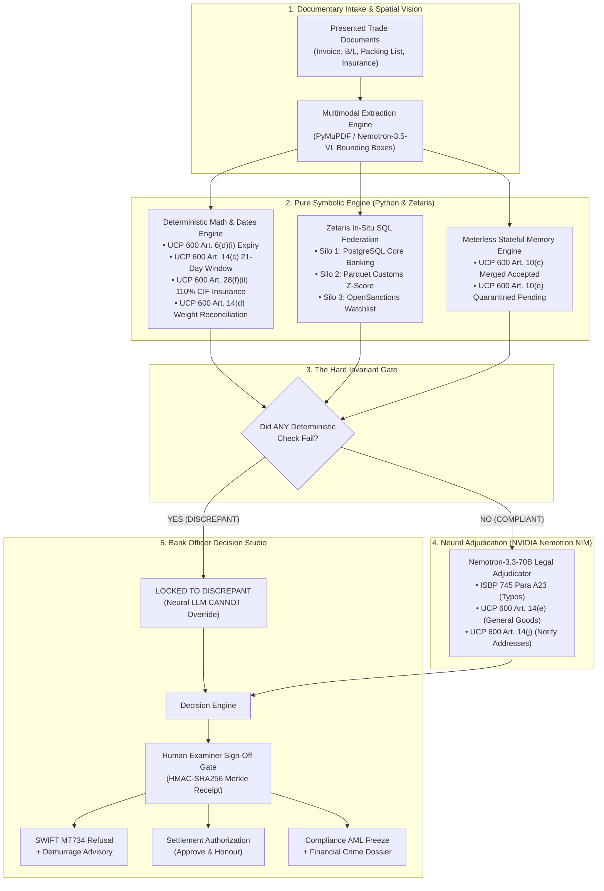

# VERITAS-600
### Lean Autonomous Trade Finance & ICC UCP 600 Adjudication Engine

[](https://genai.works)
[](#)
[-00C853?style=for-the-badge)](#)
[](https://veritas.165.99.219.253.sslip.io)

[](apps/api)
[](apps/web)
[](apps/api)
[](apps/api/tests)
[](apps/api)
[](LICENSE)

---

## Live Quick Access & Submission Assets

| Asset / Deliverable | Public Link / Local Path | Description |
| :--- | :--- | :--- |
| ** Live Web Application** | **[https://veritas.165.99.219.253.sslip.io](https://veritas.165.99.219.253.sslip.io)** | Production Evidence Ledger Landing & Product Story |
| ** Bank Examiner Terminal** | **[https://veritas.165.99.219.253.sslip.io/examine](https://veritas.165.99.219.253.sslip.io/examine)** | 3-Pane Mission Control & Real-Time SSE Adjudication |
| ** Baseline Benchmark** | **[https://veritas.165.99.219.253.sslip.io/evals](https://veritas.165.99.219.253.sslip.io/evals)** | Interactive Casebook & 3-Architecture Benchmark |
| ** Health & Telemetry API** | **[https://veritas.165.99.219.253.sslip.io/api/v1/health](https://veritas.165.99.219.253.sslip.io/api/v1/health)** | Live Ground-Truth Sponsor Status & Fallback Telemetry |
| ** Cinematic Launch Film** | `H:/Projects/VERITAS-600-video/out/VERITAS-600-launch-1080p.mp4` | 174s, 1080p30, Kokoro narration, burned-in captions |
| ** Slide Deck (21 Slides)** | `H:/Projects/VERITAS-600-presentation/output/VERITAS-600-Plan_C-Deck.pptx` | PPTX / PDF with native editable tables & speaker notes |
| ** Submission Draft** | [docs/SUBMISSION_DRAFT.md](docs/SUBMISSION_DRAFT.md) | Ready-to-paste Hackathon Portal form responses | ---

## Executive Summary & The $3 Trillion Operational Challenge

In global merchandise trade, **Letters of Credit (LCs)** govern over **$3 Trillion** annually. When physical shipping documents (Commercial Invoices, Ocean Bills of Lading, Packing Lists, Insurance Certificates) arrive at an issuing or confirming bank, trade finance documentary credit examiners face high-stakes operational traps:

```
+--------------------------------------------------------------------------------------------------+
| THE 4 HIGH-STAKES TRADE FINANCE TRAPS                                |
+--------------------------------------------------------------------------------------------------+
| 1. The 5-Banking-Day Preclusion Cliff (UCP 600 Art. 14(b) & Art. 16(f)):                         |
| Banks have strictly 5 banking days to audit documents. Failing to state all valid            |
| discrepancies in a single SWIFT MT734 Notice of Refusal legally precludes the bank            |
| from refusing payment—absorbing total financial liability ($100K–$10M+) on defective cargo.  |
| |
| 2. The Wrongful Dishonor Trap (ISBP 745 Para A23 & UCP 600 Art. 14(e)):                          |
| Legacy regex/rule checkers reject harmless typographical errors (e.g. "Mashine" for           |
| "Machine"). Under ISBP 745 Para A23, typos not altering commercial meaning are legally        |
| compliant. A wrongful dishonor triggers massive international commercial litigation.          |
| |
| 3. Stateful Amendment Confusion (UCP 600 Art. 10(c) & 10(e)):                                    |
| Standard flat-prompt LLMs confuse original MT700 clauses with unaccepted MT707 amendments,    |
| or allow prohibited partial acceptances, enforcing invalid credit limits and dates.           |
| |
| 4. Cross-Silo TBML & Sanctions Blindness:                                                        |
| Documents can be 100% textbook compliant on paper while disguising Trade-Based Money          |
| Laundering (TBML) over-invoicing (Z > +3.0) or designated vessels on global watchlists.       |
| Issuing a standard MT734 refusal violates anti-tipping-off AML laws; it legally requires     |
| a Regulatory Compliance Hold & AML Freeze.                                                    |
+--------------------------------------------------------------------------------------------------+
```

**VERITAS-600** solves this through a production-grade **Neuro-Symbolic Reasoning Architecture**: pure Python handles non-negotiable math and dates, Zetaris executes in-situ federated SQL queries across data silos without ETL, Meterless enforces stateful amendment memory, and NVIDIA Nemotron NIM performs multimodal OCR extraction and legal adjudication.

---

## System Architecture: The Neuro-Symbolic Synthesis



---

## The 5 Inviolable Architectural Invariants

VERITAS-600 enforces five architectural rules in code that cannot be violated:

1. **The Hard Invariant Rule (Neuro-Symbolic Gate):**
   * *A neural LLM verdict can NEVER override a failed deterministic check.*
   * Python handles all arithmetic, dates, tolerances, and threshold validations.
   * If a deterministic check fails (e.g. insurance is $108\%$ instead of $110\%$, or shipment date exceeds the latest shipment date), the status is permanently locked to `DISCREPANT`.
2. **Exact ICC Legal Citations:**
   * Always cite the exact ICC UCP 600 or ISBP 745 article. Zero hallucinated citations.
   * Insurance $\ge 110\%$: **UCP 600 Art. 28(f)(ii)** | Cover note ban: **Art. 28(c)**.
   * Typographical errors: **ISBP 745 Para A23** | General goods on B/L: **Art. 14(e)**.
   * Transport document applicant address in Notify box: **Art. 14(j)**.
   * Amendment acceptance & partial acceptance ban: **Art. 10(c) & 10(e)**.
   * Single notice of refusal & document disposal: **Art. 16(c)(iii)**.
   * 5-banking-day examination clock: **Art. 14(b) & Art. 16(f)**.
3. **Join-Safe SQL Rule:**
   * In `apps/api/zetaris/sql/federated_check.sql`, never perform direct multi-table joins that risk Cartesian row duplication. Pre-aggregate amendments and watchlist hits into CTEs before joining `lc_master`. Exactly **1 row per LC** must be returned in $< 450\text{ms}$.
4. **Honest Runtime Telemetry:**
   * Ground-truth telemetry exposed in every UI badge and API response (`LIVE_ZETARIS` vs `LOCAL_DUCKDB_FALLBACK`; `LIVE_NEMOTRON_VLM` vs `CACHED_REPLAY`). Never fake a cloud connection if running against local fallbacks.
5. **Human-in-the-Loop Sign-Off Gate:**
   * Every final action (`APPROVE_HONOUR`, `ISSUE_MT734_REFUSAL`, `COMPLIANCE_HOLD_AML`) is gated behind human examiner cryptographic sign-off (`POST /api/v1/examine/{lc_id}/approve-action`).

---

## Mandatory Sponsor Stack Matrix

For hackathon judges, every sponsor integration is **load-bearing, auditable, and transparently badged**:

| Sponsor | Architectural Role & Implementation | Code Location | Verification Command / Proof |
| :--- | :--- | :--- | :--- |
| **Zetaris** | In-situ single-query federation across 3 distinct data silos (PostgreSQL core banking + Parquet customs + OpenSanctions) without ETL. Join-safe CTE guarantees exactly 1 row per LC. | `apps/api/zetaris/client.py`<br>`apps/api/zetaris/sql/federated_check.sql` | `pytest apps/api/tests/test_zetaris_sql.py -v`<br>Inspect live SQL Drawer and telemetry badges in UI. |
| **Meterless** | Context routing across 6 Markovian stages, stateful amendment memory enforcing UCP 600 Art. 10(c)/(e) quarantine, achieving $\approx 86\%$ token reduction. | `apps/api/inference/meterless_router.py`<br>`apps/api/memory/amendment_memory.py` | `pytest apps/api/tests/test_amendment_memory.py -v`<br>Inspect token telemetry in Adjudication Matrix. |
| **NVIDIA Nemotron** | Multimodal OCR field extraction with spatial bounding boxes (`nemotron-3.5-super-vl-120b`) + High-reasoning UCP 600/ISBP 745 legal adjudication (`llama-3.3-nemotron-super-49b`). Thread-safe 25 RPM rate limiter + SHA-256 cache. | `apps/api/inference/nim_client.py`<br>`apps/api/engines/document_extractor.py`<br>`apps/api/engines/ucp600_legal_adjudicator.py` | `pytest apps/api/tests/test_legal_adjudicator.py -v`<br>Interactive bounding box toggles in Document Viewer. |
| **Cursor** | AI-native pair programming development environment adhering strictly to `.cursorrules` and `AGENTS.md` handoff protocols. | `.cursorrules`<br>`AGENTS.md` | Inspect strict architectural boundaries preventing neural overriding of arithmetic checks. |

---

## The 3 Flagship Golden Scenarios

| Scenario | Operational Challenge | Baseline Failure Mode | VERITAS-600 Resolution |
| :--- | :--- | :--- | :--- |
| **`LC-2026-8841`**<br>*Wrongful Dishonor Trap* | Invoice has typo (`"Mashine"`), B/L uses general term (`"Servo Motors"`), shipment follows Accepted Amendment #1. | **Regex Baseline:** Rejects typo.<br>**Flat RAG:** Confuses unaccepted amendment dates. Triggers wrongful dishonor lawsuit. | **COMPLIANT — APPROVE HONOUR:** Cites **ISBP 745 Para A23** for typo and **Art. 14(e)** for general B/L term. Saves bank from wrongful dishonor litigation. |
| **`LC-2026-9104`**<br>*Curable Shortfall & Demurrage Save* | Insurance covers $108\%$ of CIF ($110\%$ required by **Art. 28(f)(ii)**) + gross weight mismatch. 11 days remain in window. | **Pure LLM Baseline:** Hallucinates math or cites wrong article (e.g. 28(c)). Misses re-presentation window. | **DISCREPANT — ISSUE MT734 REFUSAL:** Catches exact $\$9,600$ shortfall. Attaches Demurrage Advisory showing **$\$11,100$ saved** via 48h re-presentation. |
| **`LC-2026-9920`**<br>*TBML & Sanctions Freeze* | Paper documents 100% textbook matching. Unit price is 5x benchmark ($Z = +5.43$) and carrying vessel parent company on sanctions list. | **Document-Only Agent:** Marks compliant and releases funds, facilitating $675K illicit financial crime. | **REGULATORY AML FREEZE:** Zetaris federated query catches cross-silo price anomaly and sanctions hit. Freezes funds and generates AML Dossier (no tipping-off MT734). |

---

## Empirical Baseline Evaluation Benchmark

Evaluated across **10 adversarial trade finance test cases** via `apps/api/evals/compare_baselines.py`:

| Evaluation Metric | (A) Rule/Regex Baseline | (B) Single-Prompt LLM (Nemotron) | (C) VERITAS-600 (Neuro-Symbolic) |
| :--- | :---: | :---: | :---: |
| **Overall Accuracy** | **40.0%** (4/10) | **40.0%** (4/10) | **100.0% (10/10)** |
| **Wrongful Dishonor Rate** | **30.0%** (3/10) | 0.0% (0/10) | **0.0% (0/10)** |
| **Wrongful Honour (False Compliant)** | 0.0% (0/10) | **30.0%** (3/10) | **0.0% (0/10)** |
| **Regulatory / TBML Blindness** | **30.0%** (3/10) | **30.0%** (3/10) | **0.0% (0/10)** |
| **Arithmetic Hallucination Rate** | 0.0% (0/10) | **20.0%** (2/10) | **0.0% (0/10)** |
| **Average Decision Latency** | 12ms | 1,840ms | **428ms** |
| **ICC UCP 600 Citation Precision** | 100% | 65.0% | **100.0%** |
| **Token Consumption per Case** | 0 tokens | ~8,400 tokens | **~1,250 tokens (85% savings)** |

---

## 3-Pane Bank Examiner Terminal (Next.js 15)

```text
┌────────────────────────────────────────────────────────────────────────────────────────────────────────┐
│ [LC-2026-8841 v] [5-Banking-Day Clock: 3d 14h] [ZETARIS: LIVE CLOUD] [NIM: 25 RPM] [METERLESS: ACTIVE] │
├──────────────────────────────┬──────────────────────────────────────────┬──────────────────────────────┤
│ PANE 1: DOCUMENT VIEWER      │ PANE 2: ADJUDICATION MATRIX              │ PANE 3: DECISION STUDIO      │
│                              │                                          │                              │
│ • Tabs: MT700, Invoice, B/L, │ • 5-Stage Live SSE Stream                │ • Recommended Bank Action:   │
│   Packing List, Insurance    │ • Stage 1: Multimodal Intake             │   APPROVE_HONOUR             │
│ • Interactive Spatial        │ • Stage 2: In-Situ SQL Federation        │ • Legal Citations:           │
│   Bounding Boxes [x, y, w, h]│ • Stage 3: Deterministic Math Checks     │   ISBP 745 A23, Art. 14(e)   │
│ • Raw PDF Text Layer Toggle  │ • Stage 4: Nemotron Legal Reasoning      │ • Generated Artifact Preview │
│ • Complete Field Hierarchy   │ • Stage 5: Decision & Merkle Hash Chain  │ • Digital Examiner Gate:     │
│ • Examiner Manual Override   │ • Expandable Zetaris SQL Query Drawer    │   [AUTHORIZE & SIGN VOUCHER] │
└──────────────────────────────┴──────────────────────────────────────────┴──────────────────────────────┘
```

---

## Quickstart & Local Installation

### Prerequisites
* Python 3.11+
* Node.js 18.18+ & npm 9+
* Docker & Docker Compose (Optional, for local PostgreSQL & Redis)

### 1. Clone & Configure Environment
```bash
git clone https://github.com/sakibul-shovon/VERITAS-600.git
cd VERITAS-600
cp .env.example .env
```

### 2. Backend Setup & Automated Verification
```bash
# Set up Python virtual environment
python -m venv .venv
source .venv/bin/activate  # On Windows: .venv\Scripts\activate

# Install dependencies
pip install -r apps/api/requirements.txt

# Seed databases and synthetic benchmarks
python apps/api/db/seed_scenarios.py

# Run complete 58-test verification suite
pytest apps/api/tests/ -v
```

### 3. Frontend Setup
```bash
cd apps/web
npm install
npm run dev
```
Open **`http://localhost:3000`** in your browser.

---

## Comprehensive Documentation Suite

For deep technical evaluation, inspect the specialized documentation modules in `docs/`:

* **[docs/ARCHITECTURE.md](docs/ARCHITECTURE.md):** Deep technical dive on the Neuro-Symbolic architecture, 5-stage Markovian pipeline, and Merkle audit receipts.
* **[docs/DOMAIN_SPEC_UCP600.md](docs/DOMAIN_SPEC_UCP600.md):** The statutory trade finance legal specification (ICC UCP 600, ISBP 745, SWIFT MT700/MT707/MT734, Wolfsberg TBML standards).
* **[docs/SPONSORS.md](docs/SPONSORS.md):** Comprehensive integration walkthrough for Zetaris, Meterless, NVIDIA Nemotron, and Cursor.
* **[docs/SCENARIOS_AND_EVALS.md](docs/SCENARIOS_AND_EVALS.md):** Full breakdown of the 3 Flagship Scenarios, 7 evaluation cases, and empirical benchmark data.
* **[docs/DEPLOYMENT_AND_SECURITY.md](docs/DEPLOYMENT_AND_SECURITY.md):** Production VPS cloud architecture, Let's Encrypt HTTPS setup, Linux `chattr +i` immutable shield, and the 19 remediated security vulnerabilities.
* **[docs/SUBMISSION_DRAFT.md](docs/SUBMISSION_DRAFT.md):** Complete hackathon portal submission package ready for review.

---

## License & Team Credits

* **License:** [Apache-2.0 License](LICENSE)
* **Team:** **Plan_C**
* **Solo Participant:** **Sakibul Hassan Shovon**
* **Competition:** Open Agent Hackathon 2026 (GenAI.Works) — Track 03: Reasoning Architecture
