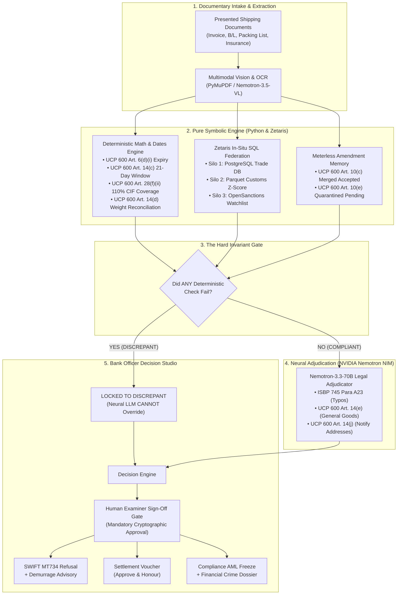

# VERITAS-600: Architecture & Technical Specification

> **Track 03:** Reasoning Architecture — *Open Agent Hackathon 2026 (GenAI.Works)*  
> **Author / Participant:** Plan_C — Sakibul Hassan Shovon (Solo Builder)  
> **Repository:** [github.com/sakibul-shovon/VERITAS-600](https://github.com/sakibul-shovon/VERITAS-600)  
> **Live Production URL:** [https://veritas.165.99.219.253.sslip.io](https://veritas.165.99.219.253.sslip.io)

---

## 1. Architectural Philosophy: The Neuro-Symbolic Split

In high-stakes trade finance ($3 Trillion annual volume), **pure neural LLM systems fail catastrophically**:
* They hallucinate arithmetic (e.g., computing $108\%$ insurance coverage as complying with the $110\%$ CIF requirement of UCP 600 Art. 28(f)(ii)).
* They hallucinate temporal boundaries (allowing presentations outside the 21-day window of UCP 600 Art. 14(c)).
* They suffer from conversational sycophancy (agreeing with prompt-injected or misleading documentary text).

Conversely, **rigid rule/regex engines fail equally hard**:
* They reject harmless typographical errors (e.g. `"Industrial AC Servo Mashine"`), causing multi-million dollar wrongful dishonor lawsuits against the bank.
* They cannot distinguish general goods descriptions on transport documents permitted under UCP 600 Art. 14(e) from conflicting descriptions.

**VERITAS-600 solves this through a strict Neuro-Symbolic synthesis**:



---

## 2. The 5 Inviolable Architectural Invariants

Every module in VERITAS-600 conforms to 5 immutable engineering laws:

### Invariant 1: The Hard Invariant Rule (Neuro-Symbolic Gate)
> **A neural LLM verdict can NEVER override a failed deterministic check.**

If a deterministic Python check fails (e.g., insurance coverage is $108.0\%$ instead of $110.0\%$, or the presentation date is 23 days after shipment exceeding Art. 14(c)'s 21-day limit), the status is permanently locked to `DISCREPANT`. The downstream LLM layer is invoked only for semantic characterization—it cannot declare the presentation compliant or clear the discrepancy.

### Invariant 2: Exact ICC Statutory Citations
> **Zero hallucinated citations. Every discrepancy, protection, or refusal must map to exact governing ICC articles.**

* Insurance $\ge 110\%$ CIF/CIP: **UCP 600 Art. 28(f)(ii)**.
* Cover note prohibition: **UCP 600 Art. 28(c)**.
* Harmless typographical errors: **ISBP 745 Para A23**.
* General goods description on non-invoice transport documents: **UCP 600 Art. 14(e)**.
* Strict invoice goods description: **UCP 600 Art. 18(c)**.
* Transport document applicant address in Consignee/Notify box: **UCP 600 Art. 14(j)**.
* Amendment acceptance and partial acceptance prohibition: **UCP 600 Art. 10(c) & 10(e)**.
* Single notice of refusal and document disposal status: **UCP 600 Art. 16(c)(iii)**.
* 5-banking-day examination clock: **UCP 600 Art. 14(b) & Art. 16(f)**.

### Invariant 3: Join-Safe SQL Federation
> **Never perform naive multi-table joins across federated silos that risk Cartesian row duplication.**

In `apps/api/zetaris/sql/federated_check.sql`, amendments and sanctions watchlist entities are pre-aggregated inside Common Table Expressions (CTEs) before joining the core `lc_master` record. Exactly **1 row per LC** is returned, guaranteeing sub-second execution ($< 450\text{ms}$) and preventing duplicated credit limit aggregations.

### Invariant 4: Honest Runtime Telemetry
> **Ground-truth badges in UI and API payloads. Never fake a live cloud connection.**

The system explicitly reports observed runtime modes:
* **Zetaris:** `LIVE_ZETARIS` vs. `LOCAL_DUCKDB_FALLBACK`.
* **NVIDIA NIM:** `LIVE_NEMOTRON_VLM` vs. `CACHED_REPLAY`.
* **Meterless:** `LIVE_METERLESS_GATEWAY` vs. `LOCAL_MARKOVIAN_ROUTER`.
* **Document Extraction:** `PDF_TEXT_LAYER` vs. `LIVE_NEMOTRON_VLM` vs. `STRUCTURED_FIXTURE`.

### Invariant 5: Human-in-the-Loop Sign-Off Gate
> **No automated autonomous bank money movement. High-consequence actions must be signed off by a human documentary credit examiner.**

Every generated outcome (`APPROVE_HONOUR`, `ISSUE_MT734_REFUSAL`, `COMPLIANCE_HOLD_AML`) produces an audit receipt with an HMAC-SHA256 Merkle root. Action execution is strictly gated behind `POST /api/v1/examine/{lc_id}/approve-action`, cryptographically binding the examiner's digital signature, run ID, and decision digest.

---

## 3. The 5-Stage Markovian Pipeline

```text
Incoming Presentation
  │
  ├─► Stage 1: Document Intake & Multimodal OCR
  │     Extracts fields + spatial bounding boxes [ymin, xmin, ymax, xmax]
  │
  ├─► Stage 2: In-Situ Federated Cross-Silo Verification (Zetaris)
  │     Silo 1 (PostgreSQL) + Silo 2 (Parquet Customs Z-Score) + Silo 3 (OpenSanctions)
  │
  ├─► Stage 3: Deterministic UCP 600 Symbolic Math & Dates
  │     Temporal validity, 110% insurance, weight reconciliation, demurrage calculations
  │
  ├─► Stage 4: NVIDIA Nemotron Legal Adjudication
  │     ISBP 745 A23 typo protection, Art. 14(e) general goods, Art. 14(j) notify address
  │
  └─► Stage 5: Bank Officer Decision Studio & Artifact Generation
        Generates SWIFT MT734 Refusal, Settlement Voucher, or AML Escalation Dossier
        + Merkle root audit seal (Pending Human Authorization)
```

### Stage 1: Document Intake & Multimodal OCR
* Directly extracts digital text layers from native PDFs.
* For scanned documents or image presentations, routes to **NVIDIA Nemotron-3.5-Super-VL-120B** to generate structured JSON with spatial bounding boxes `[ymin, xmin, ymax, xmax]`.
* Provides interactive bounding box visual inspection on the bank examiner's terminal.

### Stage 2: Zetaris In-Situ SQL Federation
* Executes `apps/api/zetaris/sql/federated_check.sql` across 3 data silos without moving or copying data:
  1. **PostgreSQL (`lc_master`, `lc_amendments`):** Retrieves base LC terms, drawing history, and amendment states.
  2. **Apache Parquet (`hs_benchmarks.parquet`):** Performs real-time unit price anomaly benchmarking against historical distributions ($Z$-score calculation).
  3. **OpenSanctions View (`watchlist_entities.json`):** Evaluates vessel IMO numbers, beneficial ownership, and applicant/beneficiary entities against global sanctions.

### Stage 3: Deterministic UCP 600 Symbolic Math & Dates
* **Temporal Audits:**
  * Expiry check under Art. 6(d)(i): $\text{Presentation Date} \le \text{Expiry Date}$.
  * 21-day presentation window under Art. 14(c): $\text{Presentation Date} - \text{Shipment Date} \le 21\text{ days}$.
  * On-board date under Art. 20(a)(ii): $\text{B/L On-Board Date} \le \text{Latest Shipment Date}$.
* **Financial Audits:**
  * Drawing amount under Art. 18(b): $\text{Invoice Amount} \le \text{Credit Drawing Limit}$.
  * Unit price arithmetic: $\text{Quantity} \times \text{Unit Price} \equiv \text{Line Total}$.
* **Insurance Audits:**
  * Document type under Art. 28(c): Rejects cover notes (`cover note` homoglyphs normalized).
  * Minimum coverage under Art. 28(f)(ii): $\text{Insured Amount} \ge 1.10 \times \text{CIF Value}$.
  * Effective date under Art. 28(e): $\text{Effective Date} \le \text{Shipment Date}$.
* **Cross-Document Reconciliation:**
  * Gross weight under Art. 14(d): Packing List vs. Bill of Lading with $\le 0.1\%$ commercial tolerance.
* **Demurrage Savings Analysis:**
  * If discrepant and remaining days in window $> 0$, calculates port demurrage savings achievable via a 48-hour re-presentation.

### Stage 4: NVIDIA Nemotron Legal Adjudication
* Evaluates documentary divergences that require nuanced legal interpretation:
  * **ISBP 745 Para A23:** Protects innocuous spelling errors (e.g. `"Mashine"` vs `"Machine"`).
  * **UCP 600 Art. 14(e):** Protects general non-conflicting goods descriptions on transport documents (e.g. `"Industrial Servo Motors"` vs `"Industrial AC Servo Machine Model X-200"`).
  * **UCP 600 Art. 14(j):** Flags applicant address mismatches in transport document Consignee/Notify boxes.
* Enforces prompt injection isolation using `<UNTRUSTED_CONTENT>` fencing and strict citation whitelisting (`VALID_CITATIONS`).

### Stage 5: Bank Officer Decision Studio & Artifact Generation
* **Action 1: `APPROVE_HONOUR`**
  * Produces official Documentary Credit Settlement Authorization Voucher.
* **Action 2: `ISSUE_MT734_REFUSAL`**
  * Generates raw SWIFT MT734 message with fields `:20:`, `:21:`, `:32A:`, `:77J:` (discrepancy list), and `:77B:` (`HOLD` disposition).
  * Attaches quantified Demurrage Advisory if the presentation window is open.
* **Action 3: `COMPLIANCE_HOLD_AML`**
  * Freezes funds immediately and generates Financial Crime / AML Escalation Dossier with Wolfsberg unit-price $Z$-score and sanctions linkage.
  * Blocks issuance of standard MT734 notice to prevent tipping off illicit networks.

---

## 4. Cryptographic Audit Chain & Merkle Receipts

Every completed examination run computes a deterministic cryptographic Merkle tree over all artifacts:
1. `lc_snapshot_hash`: SHA-256 digest of active MT700 and accepted MT707 amendments.
2. `evidence_hash`: SHA-256 digest of all extracted documentary fields.
3. `federation_receipt_hash`: SHA-256 digest of Zetaris SQL queries and telemetry.
4. `deterministic_checks_hash`: SHA-256 digest of symbolic math verdicts.
5. `legal_adjudication_hash`: SHA-256 digest of Nemotron reasoning and citations.

The Merkle root is signed via HMAC-SHA256 using `SETTINGS.ZTRV_HMAC_SECRET` and sealed into an immutable digital receipt (`V600-SIG-...`) presented on the bank examiner's terminal.
